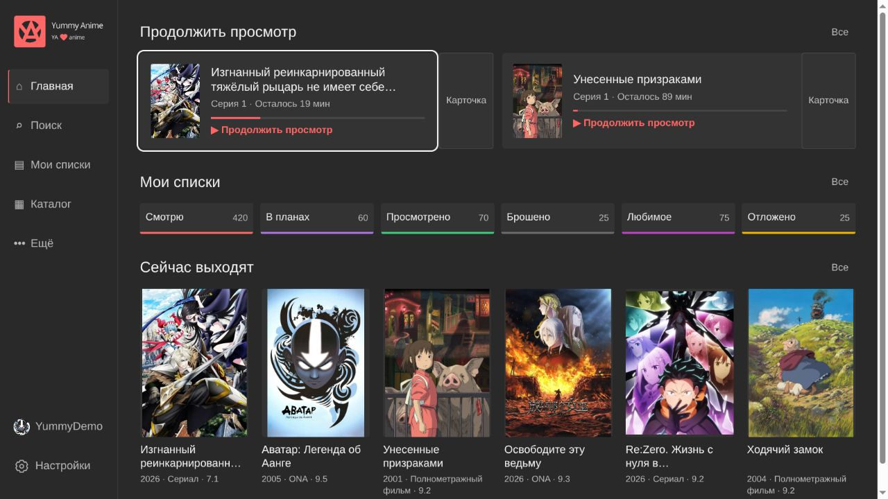
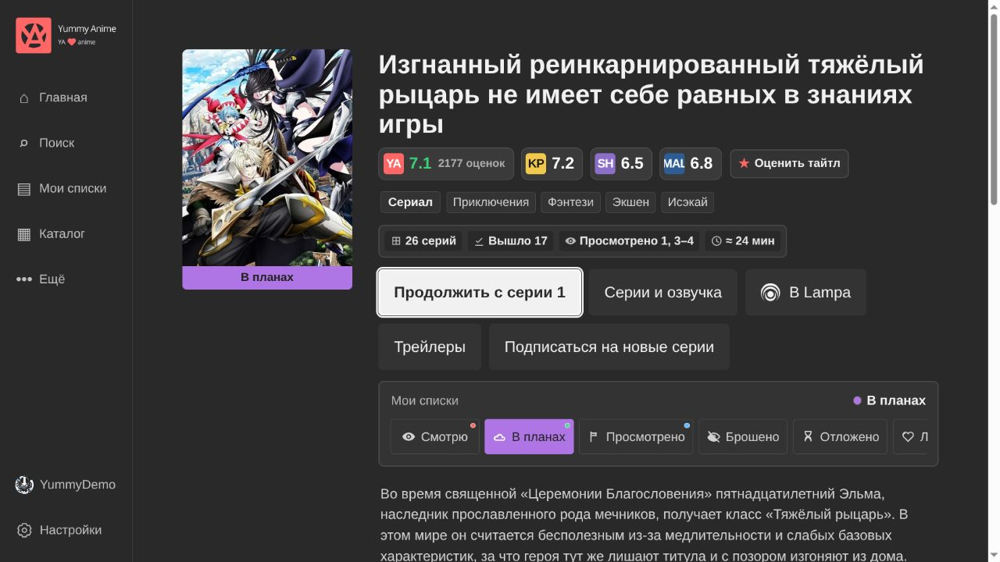
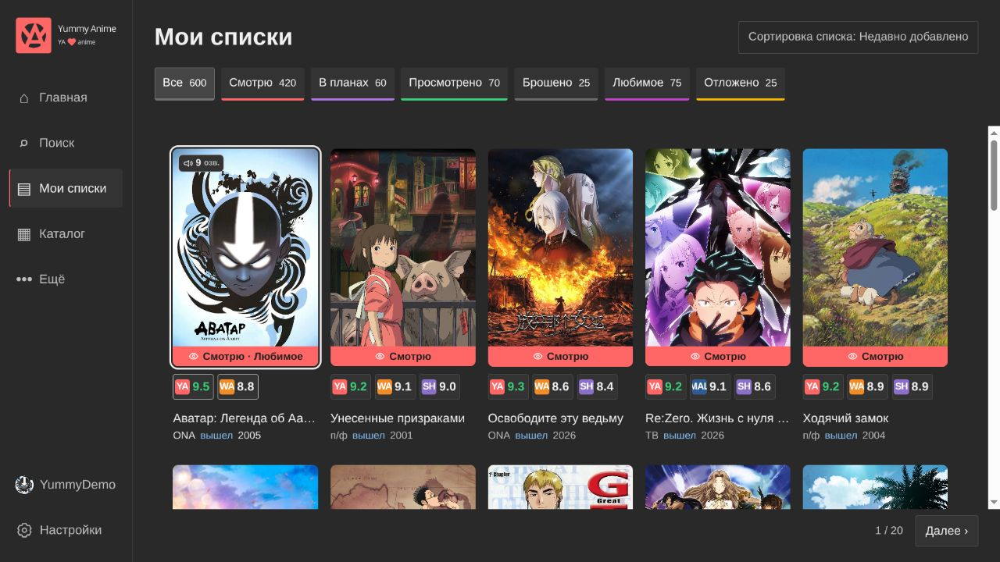
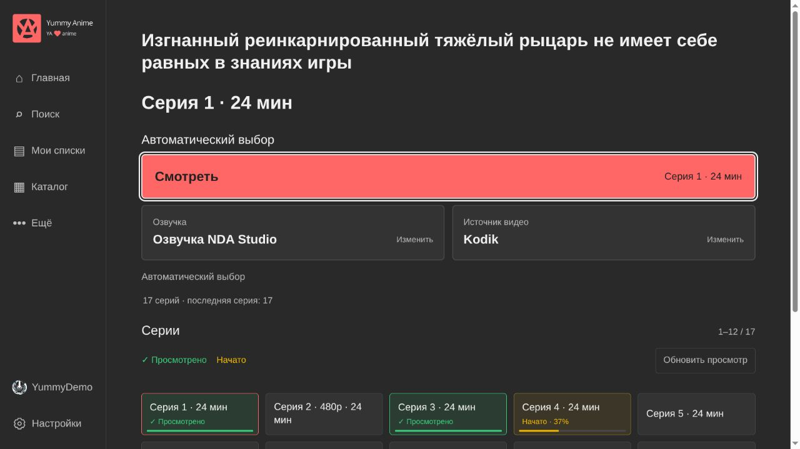
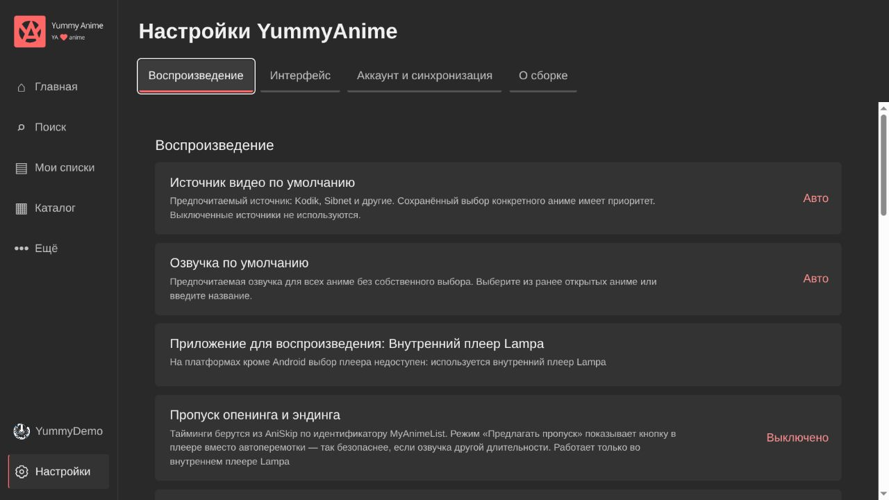
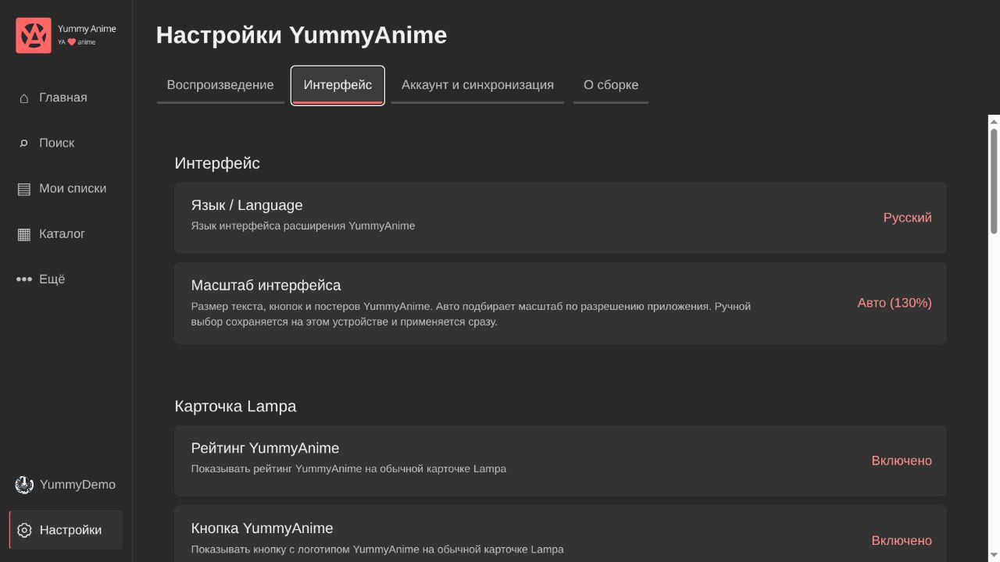
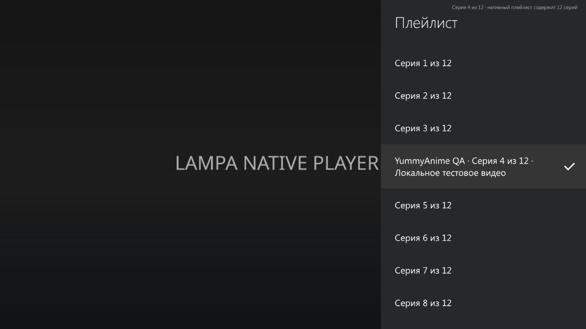

# YummyAnime for Lampa

A TV-focused fork of the official YummyAnime plugin for Lampa: anime discovery, personal lists, watch history and playback, with a charcoal/coral interface designed for remote controls.

Current version: `0.47.22` · [Official YummyAnime website](https://yummyani.me) · [Upstream project](https://github.com/yummyanime/yummy-lampa-plugin)

## Install this fork

In Lampa, open **Settings → Extensions**, add the plugin URL below, then restart Lampa:

```text
https://sergeyklimchuk.github.io/yummy-lampa-plugin/dist/index.js
```

Updates to this fork are published through its GitHub Pages deployment. The upstream `yummyanime.github.io` URLs install the original plugin and do not receive this fork’s changes. Use one distribution to avoid loading duplicate copies. The [upstream stable build](https://yummyanime.github.io/yummy-lampa-plugin/stable/index.js) is available separately.

Open **Settings → YummyAnime → Build information** to see the version, source commit, build time and whether the build contains local changes. [Build identity and deployment](docs/build-info.md).

## Screenshots

Captured on 2026-10-27 at 1280 × 720. These images show the current plugin components with public catalog data and demonstration account/history data. The native-player screenshot uses the actual Lampa 3.4.1 player with a local test video. The captures were made in a desktop browser; TV appearance also depends on Lampa’s resolution and scaling settings.

### Home



### Anime details



### My Lists



### Episodes, dubbing and source



### Settings



### Interface scaling



### Native Lampa playlist



## What this fork includes

- A TV home with Continue Watching, six personal-list shortcuts and ongoing titles. Less-used sections open on demand.
- Catalog, search, genres, rankings, schedule, collections, recommendations, updates and notifications.
- Anime details with ratings, primary playback actions and list controls near the top.
- **Watching, Planned, Completed, Dropped, Postponed** and the independent **Favorite** flag, synchronized with YummyAnime.
- An account entry showing the signed-in nickname and avatar, plus profile statistics and list counts.
- Automatic interface scaling for the app resolution, with a per-device manual override in Settings.
- A flat interface, bounded episode/option pages and reused card badges. [Rendering checks](docs/performance-lite.md).

## Playback and sources such as Alloha

Set the default source, dubbing and playback application under **Settings → YummyAnime → Playback**. Changing the dubbing or source for one anime remembers that pair locally for that anime; the global application choice stays in Settings.

The internal Lampa player receives the full playlist for the selected dubbing/source. Use its standard **Playlist** control to choose any episode, including the previous one, and **Next** to advance. Stream URLs are resolved when selected. Native Lampa handles the transition and transfer of supported player parameters. Auto-next uses Lampa’s shared player setting.

A protected source iframe is a web page rather than a playable video link; native players require a resolved stream. External-player selection is available on Android. Some sources require their own embedded web player; these do not provide the same native playlist or reliable timeline access. Alloha requires a configured direct-stream resolver or its explicitly enabled web-player fallback. [Playback preferences and source details](docs/playback-preferences.md).

## Continue Watching and synchronization

Sign in with your YummyAnime account under **Settings → YummyAnime**. The password is not stored; the plugin keeps and refreshes an account token.

The internal player saves the actual episode position locally, and—with automatic progress synchronization enabled—sends it to YummyAnime roughly once a minute and at pause, close or episode change. Account history is loaded back into Lampa so other-device progress can update Continue Watching. This is refreshed history, rather than an instant cross-device notification.

For episode-length videos of **15–40 minutes**, up to **five remaining minutes**, capped at a quarter of the video, count as completion. For a 24-minute episode, **19:00** advances Continue Watching to the next episode; **18:59** remains resumable. Shorter and longer videos retain the **95%** threshold. This is a duration-based heuristic, not detection of the credits: it does not seek or launch the next episode early. YummyAnime still receives the real time and duration.

A short press on a Continue Watching card resumes it; a long press offers **Continue Watching** or **Open anime details**. [Progress and playback behavior](docs/playback-preferences.md).

## Licensing

This is a derivative project with separately scoped licensing. The historical upstream MIT notice is preserved, and SergeyKlimchuk's own fork contributions are offered under MIT to the extent of the contributor's rights. Later upstream additions have no confirmed license in the reviewed sources; neither the fork's MIT grant nor the ownership notice supplies permission for those additions. The repository and bundle are not represented as wholly MIT-licensed.

See [licensing status and scope](LICENSE), the [third-party inventory](THIRD_PARTY_NOTICES.md) and the [machine-readable registry](licenses.json). In the plugin, open **Settings → YummyAnime → About → Licenses** to read the inventory and complete license texts without a network request. Native Lampa test fixtures and the optional Playwright server dependency are identified separately from the browser plugin. Code licenses do not cover third-party logos, posters or texts.

## Development

```sh
node build.js
node build.js --check
```

Commit source/license changes, generated `src/license-data.js`, entry-point notices and all three generated `dist` build artifacts together. The build refreshes license notices without changing the old stable program's behavior or version; feature promotion of `stable/index.js` remains a separate step. Publishing requires a successful Pages deployment.

[Technical documentation](docs/README.en.md) · [Build information](docs/build-info.md) · [Changelog](CHANGELOG.md) · [Design proposals](docs/mockups/README.md)

Original plugin by YummyAnime; this repository contains fork-specific interface and playback changes. Interface languages: Russian, English and Ukrainian.

<sub>Logos, posters and texts from third-party sources belong to their respective rights holders. The fork’s authors do not claim rights to these materials.</sub>

<sub>[Русская версия](docs/README.ru.md)</sub>
